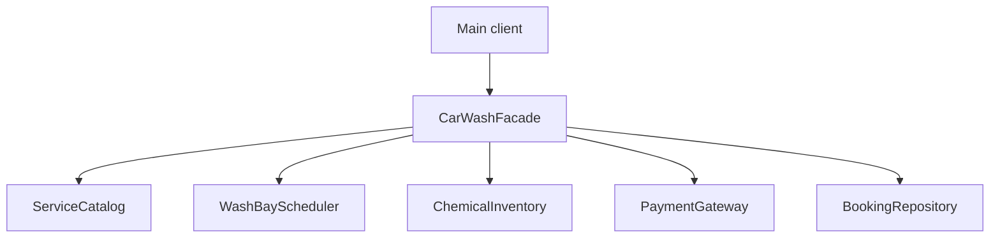

# Assignment 4 Facade Pattern

**Course:** Software Design Patterns  
**Author:** Kairbek Agzam  
**Topic:** Car wash booking and cancellation  
**Language:** Java 17  
**Dependencies:** None

This project uses one Facade to book a car wash through five subsystem classes. A booking needs a service quote, a free wash bay, chemicals, payment and a saved receipt. The client makes one business call instead of managing this sequence and its failure recovery.

## Run in IntelliJ IDEA

1. Open the `Assignment4_SDP` folder as a project in IntelliJ IDEA.
2. Set Project SDK and language level to **Java 17** or a newer JDK that supports Java 17.
3. Mark `src/main/java` as **Sources Root** and `src/test/java` as **Test Sources Root** if IntelliJ has not detected them.
4. Run `kz.agzam.carwash.client.Main` to see the Facade demo.
5. Run `kz.agzam.carwash.facade.CarWashTests` to run all 22 tests. This is a plain Java test runner, so no JUnit download is needed.
6. Optionally run `kz.agzam.carwash.advanced.DirectSubsystemExample` to demonstrate direct subsystem access.

## Run from a terminal

Install a **JDK**, not only a JRE. Run these commands from the project folder.

Windows PowerShell:

```powershell
powershell -ExecutionPolicy Bypass -File .\run.ps1 demo
powershell -ExecutionPolicy Bypass -File .\run.ps1 test
powershell -ExecutionPolicy Bypass -File .\run.ps1 direct
```

The PowerShell policy option applies only to that process and does not change system policy.

Linux or macOS:

```bash
bash run.sh demo
bash run.sh test
bash run.sh direct
```

The scripts compile both source sets using the Java compiler module with `--release 17 -Xlint:all -Werror`. Compilation warnings therefore fail the build. Each run stops on a compilation or execution failure.

## Public Facade API

```java
CarWashFacade carWash = CarWashFacade.createDemo();
BookingReceipt receipt = carWash.bookWash(
        new WashRequest("Agzam", "PREMIUM", start));
carWash.cancelBooking(receipt.bookingId());
```

`createDemo()` only wires a ready-to-run in-memory configuration. The two business operations are `bookWash` and `cancelBooking`. Their parameters and results are business values, not subsystem instances. The dependency constructor is package-private for internal wiring and tests.

The normal client is `client/Main.java`. It imports the Facade and immutable API records only. It never creates or calls a subsystem. `advanced/DirectSubsystemExample.java` is a separate, optional advanced-access demonstration. It intentionally bypasses the Facade and is not used by the normal client.

## Architecture



All five subsystem classes are public and independently usable. None imports, stores, calls or knows about the Facade. `ServiceQuote` is an immutable internal value, not a sixth subsystem service. API records also do not count towards the five required services.

| Subsystem class | Actual responsibility | How it participates |
| --- | --- | --- |
| `ServiceCatalog` | Validates and normalizes service names; returns price, duration and chemical needs | Its quote determines scheduler duration, inventory units and payment amount |
| `WashBayScheduler` | Finds a free bay and rejects overlapping time intervals | Reserves the selected time for the common booking ID |
| `ChemicalInventory` | Checks stock and tracks reserved units | Reserves the units from the service quote for the same ID |
| `PaymentGateway` | Checks balances, charges once per ID and refunds once | Charges the quote price after the resources have been reserved |
| `BookingRepository` | Stores, finds and removes confirmed booking receipts; rejects duplicate IDs | Confirms the result after scheduling, stock reservation and payment |

These services collaborate through the Facade using the same booking ID and quote values. They do not call each other directly. This follows the Facade structure: coordination is in the Facade; each service keeps its own business rules.

## Booking sequence and error handling

1. Read and validate the service quote before changing state.
2. Reserve a bay for `[start, end)`.
3. Reserve the chemicals needed by the service.
4. Charge the customer's balance.
5. Save and return an immutable confirmation receipt.

If a runtime failure happens during this sequence, the Facade refunds any payment, restores reserved chemicals, releases the bay and removes any incomplete receipt. It throws `BookingException` with context and the original cause. Refund and release operations do nothing when that ID has no reservation, so recovery works after an early or late failure.

Cancellation first finds an existing receipt. Then it refunds the charge, releases stock and the bay, and deletes the receipt. A second cancellation reports a missing booking and cannot refund twice.

`WashRequest` rejects blank customer/service values and null start times at construction. A null Facade request is a programming error and raises `NullPointerException`. Booking coordination failures and missing cancellations use `BookingException`.

## Business rules and scope

| Rule | Value |
| --- | --- |
| BASIC wash | 30 minutes, 1 chemical unit, 3000.00 KZT |
| PREMIUM wash | 60 minutes, 3 chemical units, 6000.00 KZT |
| Demo capacity | 2 wash bays and 20 chemical units |
| Demo customer balances | Agzam 20000.00 KZT; LowBalance 1000.00 KZT |
| Scheduling | Half-open intervals; a new wash may start exactly when the previous one ends |
| Money | `BigDecimal`; no floating-point money arithmetic |
| Cancellation | Full refund; only unperformed reservations are modelled |

This is a single-threaded, in-memory assignment model. It does not contact a bank, database or real wash hardware. Dates are supplied as local business times; past-date, opening-hour and timezone policies are outside the model. The demo and tests use a fixed date in 2099 for reproducibility. Chemicals are reserved, not consumed, because actual wash execution is outside the assignment.

Recovery is guaranteed for the included in-memory services under normal runtime failures; the release/refund methods have no external I/O and do not throw for absent IDs. A remote payment provider or database would need durable transactions, retries, idempotency and separate handling of recovery failures. The code does not claim distributed transaction or crash safety.

## Clean Code principles

| Principle | Where and why |
| --- | --- |
| Meaningful names | `bookWash`, `cancelBooking`, `reserve`, `refund` and `availableUnits` explain the action or value without comments |
| Single Responsibility | The Facade coordinates; the scheduler owns overlap rules, inventory owns stock rules, and payments own balance rules |
| Small focused functions | `isFree`, `reserve`, `charge` and `find` each handle one clear task; `Main.printBooking` only formats output |
| Encapsulation and least knowledge | Main sees only the Facade and business records; subsystem maps and balances are private; the Facade exposes no service getters |
| Exceptions with context | `BookingException` tells the client which operation failed and keeps the original exception as its cause |
| Do not repeat yourself | `releaseResources` is shared by booking recovery and cancellation; service prices and resource needs exist only in `ServiceCatalog` |
| Avoid magic business values | Service rules are named catalog entries, not repeated constants in Main or the Facade |
| Immutable data | Java records represent requests, quotes and receipts; callers cannot change a confirmed receipt through setters |

Some composition choices are deliberately small: concrete classes are enough for this assignment, and an extra Facade is unnecessary because booking and cancellation belong to one use case. Facade does not require a Facade interface, Singleton, or inheritance.

## Verification

Run `bash run.sh test` or the PowerShell equivalent. The runner checks **22 cases** and exits with an error if any assertion fails. It checks actual schedule, stock, balance and repository state rather than checking printed messages alone.

Covered behavior includes successful BASIC/PREMIUM bookings, simultaneous bookings in different bays, full capacity, partial overlap, adjacent slots, low/zero stock, payment failure, storage failure after payment, cancellation, duplicate refunds, missing bookings, unknown services, invalid input, normalized names, invalid configuration, and success after a failed payment.

Local verification used OpenJDK 17.0.20 on Linux. The PowerShell launcher and GitHub Actions workflow are provided but were not executed in this environment.

The storage failure is injected by a test-only repository subclass; the normal demo does not have a special failure flag.

## Requirement mapping

| Assignment requirement | Evidence |
| --- | --- |
| Java implementation of Facade | `facade/CarWashFacade.java` |
| At least four non-trivial subsystem classes | Five services in `subsystem/`; each performs stateful work or service validation and quote selection |
| Small simplified Facade API | Two public business operations; one creation factory |
| Correct coordination order | `bookWash` and its recovery sequence |
| Client only uses Facade | `client/Main.java`; no subsystem imports or calls |
| Subsystem unaware of Facade | No Facade references in any subsystem source file |
| Direct advanced access remains possible | Standalone `advanced/DirectSubsystemExample.java` |
| At least five justified Clean Code principles | Eight principles documented above |
| Complete compiling source | All `.java` files in `src`; runnable shell and PowerShell scripts |
| GitHub repository | Upload this project to a GitHub repository and submit its URL; see below |
| Topic unique in group and absent from lecture | Must be checked against classmates and Lecture 6 before submission |

## GitHub submission

This project is in [kairagz27/SDP](https://github.com/kairagz27/SDP/tree/main/Assignment4_SDP).
Submit the folder URL for Assignment 4. Clone the repository, then open `Assignment4_SDP` in IntelliJ or run the scripts from that folder.

The repository-level workflow `.github/workflows/assignment4-java.yml` compiles this project, runs its 22 tests and executes both demonstrations.

The stated deadline is **October 18, Sunday, 23:59**, end of Week 6; defense is in Week 7 practice sessions. The assignment sheet describes the work as 15% of the second attestation at the top, but refers to the first attestation in its grading heading. That administrative inconsistency does not change the 50% code / 50% defense rubric.

## References

- Assignment sheet: *Assignment 4 — Facade pattern*, supplied `SDP as4 (Facade).docx`.
- Eric Freeman and Elisabeth Robson, *Head First Design Patterns*, supplied English PDF, Chapter 7, especially printed pages 262 and 264–265: subsystem delegation, simplified interface and least knowledge.
- Robert C. Martin, *Clean Code*, supplied PDF, Chapters 2, 3, 7 and 10: meaningful names, focused functions, error handling and class responsibilities.

The source books are references only and are not redistributed in this project. Lecture 6 was not supplied, so its exact example and group topic availability cannot be verified here.
