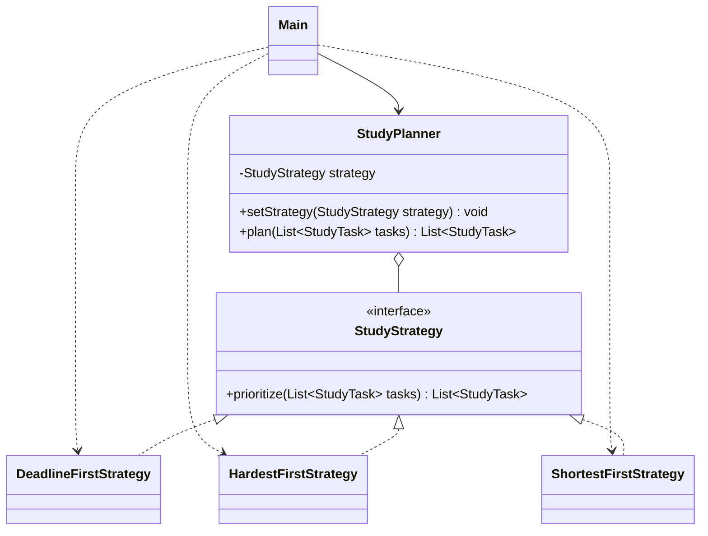

# Assignment 5 Strategy Pattern

**Курс:** Software Design Patterns

**Автор:** Kairbek Agzam, SE25-13

**Тема:** Распределение учебных задач по сроку, сложности или длительности

**Java:** 17 или новее

**Внешние зависимости:** нет

Студент выбирает, в каком порядке выполнять учебные задачи: сначала ближайшие дедлайны, самые сложные или самые короткие работы. `StudyPlanner` делегирует построение списка выбранной стратегии. Во время работы клиент меняет стратегию на том же объекте планировщика.

Приложение определяет порядок задач. Оно не распределяет их по календарю и не учитывает доступные часы. Даты в демо фиксированы для воспроизводимости; дата в прошлом допустима и означает просроченную задачу.

## Запуск

В IntelliJ IDEA откройте папку `Assignment5_SDP`, выберите JDK 17 или новее. При необходимости отметьте `src/main/java` как Sources Root, а `src/test/java` как Test Sources Root. Запустите `kz.agzam.study.client.Main`; для проверок — `kz.agzam.study.StudyPlannerTests`.

Из папки `Assignment5_SDP` в Windows PowerShell:

```powershell
powershell -ExecutionPolicy Bypass -File .\run.ps1 demo
powershell -ExecutionPolicy Bypass -File .\run.ps1 test
```

Параметр ExecutionPolicy действует только для запущенного процесса.

В Linux или macOS:

```bash
bash run.sh demo
bash run.sh test
```

Нужен JDK с командами `java` и `javac` в PATH. Скрипты компилируют оба набора исходников с `--release 17 -encoding UTF-8 -Xlint:all -Werror`. Ошибка компиляции, предупреждение или провал проверки завершают запуск с ошибкой. Maven и JUnit не требуются.

## Компоненты Strategy

| Роль | Класс | Ответственность |
| --- | --- | --- |
| Strategy | `StudyStrategy` | Объявляет общий метод `prioritize(List<StudyTask>)` |
| Concrete Strategy | `DeadlineFirstStrategy` | Сначала ближайший дедлайн |
| Concrete Strategy | `HardestFirstStrategy` | Сначала максимальная сложность |
| Concrete Strategy | `ShortestFirstStrategy` | Сначала минимальная длительность |
| Context | `StudyPlanner` | Хранит ссылку на интерфейс, делегирует выполнение, позволяет заменить стратегию |
| Client | `Main` | Создаёт задачи, выбирает стратегии и выводит результат |
| Данные | `StudyTask` | Неизменяемая задача: название, дедлайн, сложность и оценка времени |



Основная логика контекста:

```java
public List<StudyTask> plan(List<StudyTask> tasks) {
    return strategy.prioritize(List.copyOf(tasks));
}
```

В контексте нет `if`, `switch`, `instanceof` или импортов конкретных стратегий. Метод, который будет выполнен, определяется полиморфизмом. `List.copyOf` проверяет список и его элементы на `null` и передаёт стратегии неизменяемый снимок входа.

## Правила алгоритмов

| Стратегия | Основной критерий | При равенстве |
| --- | --- | --- |
| DeadlineFirst | Дедлайн по возрастанию | Название по естественному порядку Java String |
| HardestFirst | Сложность по убыванию | Ближайший дедлайн, затем название |
| ShortestFirst | Минуты по возрастанию | Ближайший дедлайн, затем название |

При полном совпадении ключей сохраняется исходный порядок. Все задачи, включая повторяющиеся, остаются в результате. Три реализации возвращают новый неизменяемый список и не меняют исходный. Они используют стандартную сортировку Java с разными правилами приоритета: изменяемое поведение здесь — именно выбор приоритета задач.

`StudyTask` отклоняет пустое название, сложность вне диапазона 1–5 и длительность не больше нуля через `IllegalArgumentException`. Отсутствующие название или дедлайн вызывают `NullPointerException`. Пробелы по краям названия удаляются. Планировщик также отклоняет `null` вместо стратегии, списка или его элемента. Пустой список допустим. Отклонённая замена стратегии сохраняет предыдущую.

## Пример результата

Демо последовательно использует три стратегии на одном `StudyPlanner`:

| Режим | Порядок задач |
| --- | --- |
| По сроку | English vocabulary → Database report → Strategy implementation → Algorithms problem set |
| По сложности | Algorithms problem set → Strategy implementation → Database report → English vocabulary |
| По длительности | English vocabulary → Algorithms problem set → Strategy implementation → Database report |

Переключение делает клиент:

```java
StudyPlanner planner = new StudyPlanner(new DeadlineFirstStrategy());
planner.plan(tasks);
planner.setStrategy(new HardestFirstStrategy());
planner.plan(tasks);
planner.setStrategy(new ShortestFirstStrategy());
planner.plan(tasks);
```

## Принципы Clean Code

| Принцип | Где применён и зачем |
| --- | --- |
| Полиморфизм вместо ветвления по типу | `StudyPlanner.plan` вызывает интерфейс; при добавлении алгоритма не появляется новая ветка в контексте |
| Single Responsibility | Каждая стратегия отвечает за одно правило порядка; `StudyTask` хранит и проверяет данные, `Main` занимается конфигурацией и выводом |
| Осмысленные имена | `DeadlineFirstStrategy`, `estimatedMinutes` и `setStrategy` явно называют поведение, единицу измерения и действие |
| Независимость контекста от алгоритма | `StudyPlanner` зависит от `StudyStrategy`; он не знает критерии сортировки и устройство реализаций |
| Open Closed Principle | Новая реализация интерфейса подключается через конструктор или setter без изменения контекста и существующих стратегий |
| Небольшие методы | `prioritize`, `plan` и `printPlan` выполняют по одной понятной операции |
| Инкапсуляция и неизменяемые данные | Поле стратегии закрыто; `StudyTask` — record; входной список копируется, что предотвращает побочные изменения |

Проверки `if` в конструкторе данных проверяют допустимость значений. Они не выбирают конкретную стратегию и не заменяют полиморфизм.

## Расширение без изменения существующих классов

В тесте `extensionStrategy` добавлен четвёртый алгоритм — сначала самые длительные задачи:

```java
StudyStrategy longestFirst = tasks -> tasks.stream()
        .sorted(Comparator.comparingInt(StudyTask::estimatedMinutes).reversed()
                .thenComparing(StudyTask::deadline)
                .thenComparing(StudyTask::title))
        .toList();
StudyPlanner planner = new StudyPlanner(longestFirst);
```

Лямбда реализует функциональный интерфейс с одним методом. Её также можно вынести в отдельный класс `LongestFirstStrategy implements StudyStrategy`. Меняется конфигурация в новом клиенте; `StudyPlanner` и три существующие стратегии остаются прежними. Новый алгоритм обязан соблюдать контракт интерфейса: возвращать все задачи, не изменяя вход.

## Проверки

`StudyPlannerTests` выполняет 12 поведенческих проверок: три основных порядка, переключение стратегий на одном объекте, разрешение равных приоритетов, сохранность входа и повторяющихся задач, пустой список, одна задача, валидация данных, недопустимая стратегия, отсутствующие входные данные и подключение четвёртого алгоритма.

Проверяются сами списки и исключения, а не только текст в консоли. Проверки не зависят от JVM-флага `-ea`: ошибка выбрасывает `AssertionError`. Репозиторный workflow `.github/workflows/assignment5-java.yml` запускает тесты и демо на Java 17.

## Подготовка к защите

**Что изменяется?** Правило определения приоритета учебных задач. Данные и интерфейс планировщика остаются одинаковыми.

**Где хранится стратегия?** В закрытом поле `StudyPlanner.strategy`, тип которого — интерфейс `StudyStrategy`.

**Кто выбирает алгоритм?** Клиент `Main`. Контекст только вызывает `prioritize` у текущего объекта стратегии.

**Как доказать смену во время работы?** Показать один объект `planner`, два вызова `setStrategy` и три разных списка для одних данных.

**Почему композиция?** Планировщик содержит заменяемый объект стратегии. Не требуется создавать подкласс планировщика для каждого правила.

**Чем это отличается от State?** Здесь клиент явно выбирает нужный алгоритм. Модель не описывает внутренние состояния объекта и переходы между ними.

**Почему не один switch?** Ветвление связывало бы контекст с каждым вариантом. Интерфейс позволяет добавить алгоритм без редактирования контекста.

**Всегда ли нужна самая сложная задача первой?** Нет. Каждая стратегия выражает отдельную цель студента. HardestFirst может поставить позднюю сложную работу раньше близкого простого дедлайна; это сознательное правило выбранного режима.

## Соответствие заданию

Реализованы интерфейс стратегии, три конкретных алгоритма, контекст со сменой стратегии во время работы и клиент без выбора типов внутри контекста. Выше обоснованы семь принципов Clean Code и показана расширяемость. Исходники компилируются без внешних библиотек.

Перед сдачей нужно проверить уникальность темы в группе и отсутствие такого примера на лекции: материалы лекции и список тем группы не входят в проект.

Ресурсы задания: Freeman и Robson, *Head First Design Patterns*, глава 1; Martin, *Clean Code*, глава 10; Lecture 7 и материалы Moodle.
